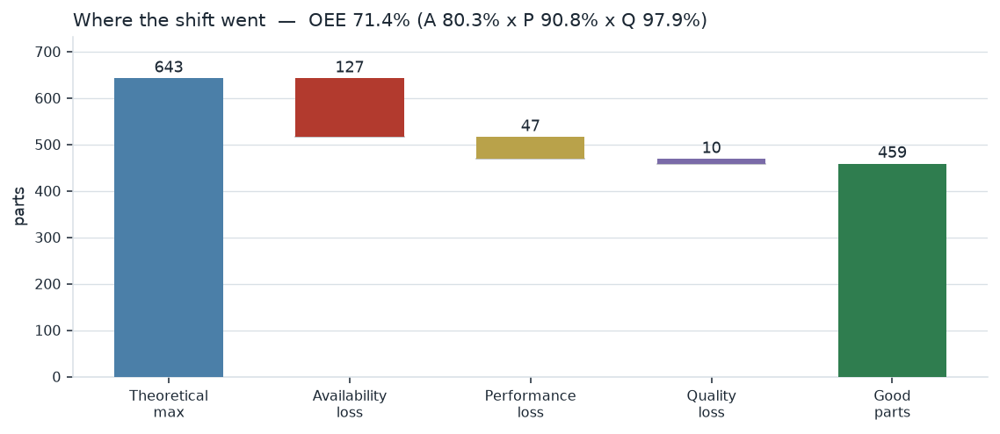
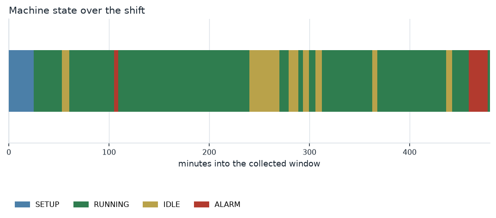
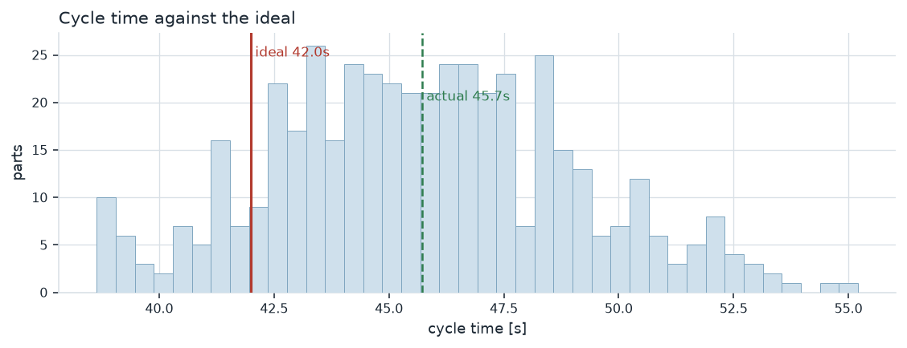

# OPC UA Machine Monitor

A simulated CNC machining centre published as an **OPC UA server**, a client
that **browses and subscribes** to it, a **SQLite** historian, and an **OEE**
analysis with a shift report.

Shop-floor connectivity end to end, in one repo: machine → OPC UA → database →
KPI. The parts that matter are the ones that are easy to get wrong — which
timestamp you trust, what counts as planned production time, and what a
counter reset does to your part count.

```bash
pip install -r requirements.txt
python run.py demo              # server + collector + report in one command
python tests/test_oee.py        # 18 checks, no server needed
```

The demo replays an eight-hour shift at 1200× — about 24 seconds of wall clock
— over a real OPC UA socket between two asyncio tasks. The client browses the
address space and subscribes exactly as it would against a controller.

---

## Result on one simulated shift

```
samples collected   1,541   (dropped 0)
latency             median 107.0 ms, p95 199.8 ms

observed window     8h 00m
planned stops       0h 30m
planned production  7h 30m
run time            6h 01m
  IDLE              1h 10m
  SETUP             0h 25m
  ALARM             0h 22m

parts               469 total, 459 good, 10 scrap
cycle time          ideal 42.0 s, actual 45.7 s

Availability          80.3%
Performance           90.8%
Quality               97.9%
OEE                   71.4%
```



The waterfall is the version a production meeting can argue with: 643 parts
were theoretically possible, 127 were lost to stops, 47 to running slow, 10 to
scrap, and 459 came out good.



The timeline is why the chart exists rather than just the total. **22 minutes
of alarms is one long stop at the end of the shift, not a drizzle of short
ones** — and those have completely different responses. A single long stop is
a maintenance question; thirty short ones are a process question.

## The three things that decide whether an OEE number is real

**1. Which timestamp you trust.** Every sample carries three: `source_ts` (when
the machine says it changed), `server_ts` (when the OPC UA server processed
it), and `received_ts` (when the collector got it). OEE is computed from
**source timestamps only**.

This is not pedantry. A controller that buffers during a network outage sends
values whose source timestamps are minutes old; a collector keyed on arrival
time would smear a whole outage into the second the link came back, and the
downtime would simply vanish from the report. In this repo the same mechanism
is what lets an eight-hour shift replayed in 24 seconds still report eight
hours — the server stamps the simulated machine clock, and everything
downstream believes it.

Measured latency here is a median of 107 ms against a 200 ms publishing
interval, which is exactly half a cycle — what you would expect when changes
arrive uniformly between publishes. It does not bias the OEE at all; it only
tells you how live a dashboard on this feed would be.

**2. Planned production time is not in the machine data.** A controller reports
`IDLE` for a planned break and `IDLE` for waiting on material. They are the
same state on the wire, and no amount of cleverness separates them — only the
shift plan knows. So planned stops are **passed in**, never inferred.

In this shift that is worth 5.0 points of availability (75.3% → 80.3%) and 4.5
points of OEE (66.9% → 71.4%). Counting the break as downtime is the most
common way an OEE figure comes out wrong, and it always makes the machine look
worse than it is.

**3. Counters reset.** A parts counter that goes 418 → 0 at a job change has
not produced minus 418 parts. Totals are the sum of **positive deltas**, seeded
from the first observed value, so a reset costs nothing and a collector that
attaches mid-shift does not claim the parts made before it connected.



Every part runs 3.7 s over the 42 s ideal. Across 469 parts that is 29 minutes
of shift — the performance loss, in a form a process engineer can chase.

## Why subscriptions, not polling

The collector asks the server to **push** changes rather than reading tags on a
timer. A poll at any interval misses everything that happens between polls, and
on a machine the short states are the interesting ones: a 40-second alarm that a
60-second poll never observes is 40 seconds of downtime that never reaches the
number.

Details that matter in the implementation:

- `queuesize=200` on the subscription. With the default of 1 the server
  overwrites buffered notifications between publishes, so a burst — several
  parts completing inside one publishing cycle — arrives as a single value and
  the rest are silently lost.
- The notification callback does **nothing slow**. It puts the sample on an
  asyncio queue and returns; a separate writer task batches into SQLite. A
  callback that blocked on a database commit would stall the subscription and
  the server would start discarding.
- When the local queue is full the collector **says so** and counts the drops,
  rather than losing data quietly. A dropped sample is a hole in the OEE
  calculation, not a cosmetic problem.

## Address space

Browsed, not hard-coded, so pointing the collector at a machine with extra
nodes picks them up without a code change.

```
Objects/
└── Machine/
    ├── Identification/   Manufacturer, Model, SerialNumber
    ├── Monitoring/       MachineState, SpindleSpeed, SpindleLoad,
    │                     FeedOverride, AxisTemperature, ToolNumber
    ├── Production/       JobIdentifier, ActiveProgram, PartsProduced,
    │                     PartsScrapped, CycleTime
    └── Alarms/           AlarmCode, ActiveAlarm
```

Folders rather than a flat tag list, because that structure is what lets a
client understand a machine it has never seen — the actual argument for OPC UA
over a bespoke TCP protocol. Every tag declares an explicit variant type:
letting the library infer from the first value is how a counter that starts at
integer 0 later rejects a float.

## Layout

| File | Role |
|---|---|
| `src/machine.py` | Shift simulation. Pure — builds a timeline, knows nothing about OPC UA. |
| `src/server.py` | OPC UA server; address space and timeline replay. |
| `src/collector.py` | Client: browse, subscribe, queue, batch-write. |
| `src/store.py` | SQLite schema and queries. Three timestamps per sample. |
| `src/oee.py` | OEE from tag changes. Pure — no I/O. |
| `src/charts.py`, `src/report.py` | Timeline, waterfall, cycle histogram, PDF report. |
| `src/paper.py` | Page composition: A4 pages, tables, figure bands. |
| `run.py` | `demo`, `server`, `collect`, `analyse`. |

The simulation and the OEE maths are deliberately free of async I/O. That
separation is the only reason the test suite can exist without a server.

### Running the two halves separately

```bash
python run.py server --speed 240        # terminal 1
python run.py collect --duration 120    # terminal 2
python run.py analyse --planned-stop 1800
```

Any OPC UA client works against the server — UaExpert, FreeOpcUa's GUI, or your
own. The endpoint is `opc.tcp://127.0.0.1:4840/cnc/`.

## Testing

```
18/18 passed
```

Hand-computed anchors rather than golden output:

- 8000 s run in a 10 000 s window, 160 parts at a 40 s ideal, 8 scrap →
  A 0.80 × P 0.80 × Q 0.95 = **OEE 0.608**, asserted exactly
- declaring a planned break must *raise* availability, not lower it
- a counter going 400 → 418 → 0 → 12 is **30 parts**
- repeated identical state values must not create intervals or inflate the
  stop count
- the loss waterfall must close, and good parts must equal theoretical × OEE
- performance above 100% must be **flagged**, not hidden — the machine cannot
  beat its own ideal cycle, so a declared ideal that is too slow is a data
  error worth surfacing
- the analyser re-run against the simulation's own ground truth must recover
  the part count, scrap count and mean cycle time

That last test caught a real distinction worth keeping. Measured `RUNNING`
time is consistently *larger* than the time spent on completed cycles, because
every stop interrupts a part mid-cycle: the machine was running and no part came
out. That gap is a genuine performance loss, not an accounting error, and the
test now asserts the sign and bounds it at one cycle per production burst.

## Fachbegriffe

| English | Deutsch |
|---|---|
| Overall equipment effectiveness | Gesamtanlageneffektivität (GAE/OEE) |
| Availability / Performance / Quality | Verfügbarkeit / Leistung / Qualität |
| Planned production time | Geplante Produktionszeit / Belegungszeit |
| Unplanned downtime | Ungeplante Stillstandszeit |
| Cycle time | Taktzeit |
| Setup / changeover | Rüsten / Rüstvorgang |
| Scrap / rework | Ausschuss / Nacharbeit |
| Machine data acquisition | Maschinendatenerfassung (MDE) |
| Shop floor / production control | Fertigungssteuerung |
| Alarm / fault | Störung |
| Tool breakage | Werkzeugbruch |

## Scope

The machine is simulated. Everything between the server socket and the report
is real: a real OPC UA address space, real browsing, a real subscription with
real publishing cycles, real timestamps.

Not implemented: security (the endpoint is anonymous and unencrypted — a plant
server would use certificates and Sign&Encrypt), the full OPC UA for Machine
Tools companion specification (the folder structure is shaped like it, not
compliant with it), alarms & conditions as proper OPC UA events rather than
tags, historical access via the server's own HA service, and reconnection with
backfill after an outage. The last one is the first thing I would add: it is
where the source-timestamp argument above stops being theoretical.

---

Built by [Prathamesh Bedre](https://github.com/Pratsss24) — M.Sc. Intelligent
Manufacturing, TU Clausthal. Companion repos:
[cmm-spc-dashboard](https://github.com/Pratsss24/cmm-spc-dashboard) (capability
and control charts from CMM data) and
[tolerance-stackup](https://github.com/Pratsss24/tolerance-stackup).
